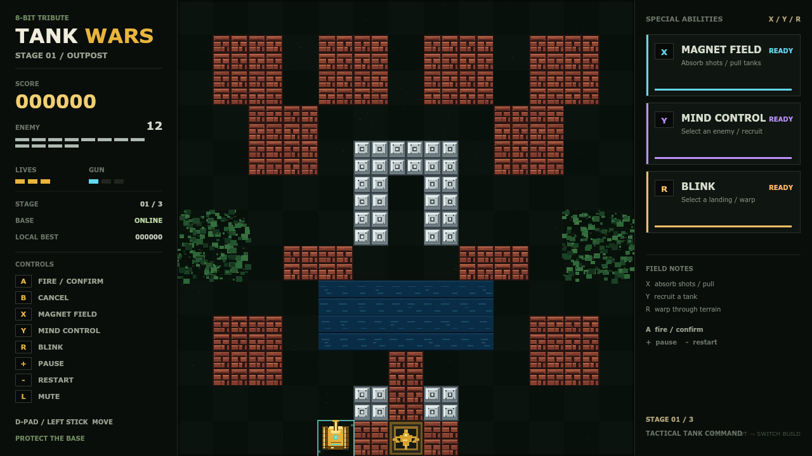

# TANK WARS · Nintendo Switch 测试包

这是一个自包含的 **nx.js** fat NRO，使用 Switch 的手柄 API 运行三关完整游戏，并支持**双人同屏**。



瞄准模式预览：`preview-aim.png`。

## 构建

```bash
cd switch
./build.sh
```

产物：`switch/tank-wars.nro`。

构建不需要 devkitPro；`@nx.js/nro` 已经包含打包所需的 nx.js runtime。脚本会把源码镜像到 `/tmp` 再构建，以避开部分 macOS 环境里 esbuild 扫描桌面目录卡住的问题。

当前版本：**0.2.2**。

## 安装到 Switch

1. 把 `tank-wars.nro` 复制到 SD 卡目录：`/switch/tank-wars.nro`。
2. 在大气层 hbmenu 中启动 `TANK WARS`。
3. **必须从应用模式启动**：在主页选中任意游戏，按住 `R` 再按 `A` 打开 hbmenu，然后启动本 NRO。相册 applet 模式只有约 380 MiB，当前 720p 画面会触发 NX.js/V8 的 native heap OOM 并闪退。

如果从相册直接启动，`/switch/nxjs-debug.log` 会看到 `regime=applet` 和 `FATAL JS heap OOM`，这不是游戏逻辑问题。

### 0.2.4 点阵中文

- 回退 0.2.3 的自定义字体方案：实机在关卡开场大量绘制中文时卡死。
- 改用内嵌 14×14 点阵字模，纯 `fillRect`，不经过字体引擎。

### 0.2.3 界面汉化

- 标题、人数选择、关卡开场、暂停/过关/失败、瞄准提示、技能说明和结局彩蛋全部中文。
- 与网页端一致的混合风格：HUD 标签保留英文（`P1 SCORE`、`ENEMY`、`LIVES`、`GUN`、`STAGE`、`BASE`、`LOCAL BEST`、`READY/LIVE/AIM/WAIT`、`MUTE/PAUSE/RESTART`），任务、说明、操作提示、关卡界面和彩蛋使用中文。
- NX.js 只加载 Switch 的 Standard 共享字体，不含简体中文字形。0.2.3 曾尝试内嵌 TTF + `FontFace`，实机在进入关卡时卡死；0.2.4 改为内嵌 **14×14 中文点阵**（`switch/src/cjk-glyphs.js`），只用 `fillRect` 绘制。
- 关卡代号 CRADLE / HOMESTEAD / DUSK 作为英文副标保留。
- 字模可用 `python3 tools/build-cjk-bitmap.py <NotoSansSC_400Regular.ttf>` 重新生成；字形来自 Noto Sans SC（SIL OFL），许可证见 `switch/NotoSansSC-OFL.txt`。

### 0.2.2 音频自动重试与诊断

- 实机反馈“开场没声音、按技能才突然有声音”：音频输出在启动阶段可能尚未就绪，早期的音效会被丢弃。现在 `AudioEngine` 创建 AudioContext 失败后每 250ms 自动重试（最多约 15 秒），不再等下一次按键。
- 左侧栏 `MUTE` 位置在音频未就绪时显示红色 `NO AUDIO`。
- 日志新增 `[audio] ready ... t=...`、`[audio] context state=...`、前 12 个音效的 `[audio] sfx <name> t=...` / `skipped ...`。
- 若实机仍异常，请把 `/switch/nxjs-debug.log` 里所有 `[audio]` 行发回。

### 0.2.1 人数选择与双人瞄准减速

- 人数改为在标题页手动选择：十字键 / 左摇杆左右切 1P / 2P，`A` 开始。
- 选 2P 后立即出现两辆坦克；第二个手柄接上就直接控制 P2，中途连接也生效。
- 双人瞄准（心念支配 / 瞬移）时，敌方坦克与敌方炮弹降到 12% 速度，另一名玩家的坦克保持全速。

### 0.2.0 双人同屏

- 手柄 1 控制 P1（金色），手柄 2 控制 P2（青色），每个手柄都有完整的十字键 / 左摇杆、A、B、X/Y/R 映射。
- 每人独立生命、分数、火力、复活和技能冷却；左侧栏显示 P1 / P2 双分数、双生命/火力，右侧栏显示两套技能卡。
- 前两关两人都阵亡才 GAME OVER；第三关每人 1 条最终生命，两人都倒下或老鹰被击毁才进入彩蛋。
- 同一时间只允许一个人进入战术瞄准。
- `switch/tank-wars.nro` 已重新打包；尚未在大气层实机验证双人手柄与双人 HUD。

### 0.1.8 三关新剧本与结局彩蛋

- 关卡改为 **CRADLE → HOMESTEAD → DUSK**：石头封死的老鹰、只剩砖墙的老鹰、完全没有保护的老鹰。
- 第三关敌军无限，左侧 ENEMY 显示 `∞`；每人只有 1 条命。
- 老鹰没有任何特殊保护，敌方炮弹、流弹和玩家自己的炮弹都能一炮击毁它。
- 第 60 秒，命运坦克在老鹰正上方显形，炮口朝下开炮，作为保底演出转入结局彩蛋；两人都阵亡也会进入彩蛋。
- 彩蛋在 Switch 端是 416 × 416 Canvas 英文版，A 键可以再玩一次。

### 0.1.4 真正的 native 内存根因：系统字体重复注册 + 音频节点堆积

实机上三次崩溃的共同点是 `native heap` 涨到 3.2 GB，而 JS 堆只有几 MB：

- 0.1.0：每帧多次 832×832 `drawImage` 合成，约 6 秒耗尽。
- 0.1.1：720p `putImageData` 在 GPU 后端反复分配临时纹理，约 15 秒耗尽。
- 0.1.3：CPU raster + 416×416 离屏合成，仍然约 42 秒耗尽。

继续对比参考项目后，找到了两个**与画布渲染无关**的持续分配源：

1. **`ctx.font` 的系统字体重复注册（主因）**
   NX.js 的系统字体以 `weight: "normal"` 注册；`ctx.font = "600 10px system-ui"` 这种带数字字重的写法会让 `findFont()` 匹配失败，于是每次设置字体都会调用 `addSystemFont()`，把整套系统字体数据复制进 native 内存并永久加入全局 `FontFaceSet`。侧栏每次重绘会切换很多字号/字重，所以 native heap 会快速上涨。
   参考项目的 HUD 全部使用自绘点阵字体，完全不碰 `ctx.font`，所以没有这个问题。

   修复：侧栏只请求 `normal <size>px system-ui`，并缓存当前 font 字符串；需要粗体时用一次 1px 偏移的二次绘制模拟，不再注册新字体。

2. **音频 Buffer / Source 节点堆积**
   NX.js 要等 JS GC 才释放原生音频节点，而且不会把音频内存报告给 V8。原实现每个音效都新建 AudioBuffer + BufferSource，既不复用也不断开；爆炸音效还带随机失谐，导致每个音效都是新缓冲。
   修复：按参数缓存最多 96 个生成缓冲、随机失谐量化为固定档位、播放结束在 `onended` 里 `disconnect()` 并释放 buffer 引用、静音改为直接赋值（不再使用 NX.js 不会清理的 AudioParam 自动化）。

渲染路径保留 0.1.1/0.1.2 的 **720p 单画布直绘 + CPU raster**：没有画布间 `drawImage`，地形写入一块复用的 `ImageData`，树林直接绘制，侧栏只在数值变化时重绘。

启动后每 5 秒会写一行诊断日志：

```text
[diag] 10s fonts=2 heap=... external=...
```

`fonts` 应该稳定在 **2**（system-ui + sans-serif）。如果它持续增长，说明还在重复注册字体。

### 0.1.7 Switch 音频初始化与音量

Switch 实机没有声音时，常见原因有三个，这一版都做了处理：

- **AudioContext 查找时机**：DOM shim 在模块加载时快照 `window.AudioContext`；如果运行时稍后才安装这个全局，快照会是 `undefined`，`ensure()` 直接静默返回。现在改为每次 `ensure()` 时重新读取 `globalThis.AudioContext`。
- **初始化时机**：Switch 没有浏览器自动播放限制，改为在 `boot()` 时直接初始化音频（和参考项目一致），不再等第一次按键。
- **音量**：buffer 模式的 master gain 从 0.14 提高到 0.35，并对每个合成音效额外做 2× 增益，接近参考项目在 Switch 上的响度，避免实机扬声器上几乎听不见。
- 音频初始化/播放加了 try/catch 和诊断日志：`[audio] ready ...`、`[audio] first source ...`、`[audio] error ...`；失败也不会再中断输入或游戏循环。
- 左侧栏新增 `MUTE / UNMUTE` 音效开关，如果误按 L 静音可以直接看到。

### 0.1.6 关闭 Switch 屏幕抖动

敌军坦克被击毁时原本会触发 `shake`。在 Switch 的直绘路径里，地形是 `putImageData` 写入的，不跟随画布变换，所以抖动会表现为“地形不动、坦克/子弹在跳”，看起来像地图刷新。0.1.6 在 Switch 主机上完全关闭屏幕抖动，并去掉击毁敌军/友军损失时的抖动触发；爆炸粒子、闪光和音效保留。Web 端仍保留原来的抖动效果。

### 0.1.5 出生点防卡死

玩家或策反友军站在敌军出生点时，不会再让刷怪停摆：

- 待生成点被占，自动改选其他空闲出生点；
- 三个出生点都被占超过约 2.4 秒，会把占点的友军轻推到附近空位，玩家同时获得约 1.4 秒护盾，然后继续生成。

如果仍然卡顿或闪退，请把 `/switch/nxjs-debug.log` 发回来，重点看 `[diag]` 行里的 `fonts=` 是否增长，以及 `[skia] using raster path`、`regime=`、`native heap:`。

## 手柄操作

每个已连接的手柄控制一名玩家（手柄 1 = P1，手柄 2 = P2）：

| 输入 | 功能 |
| --- | --- |
| 十字键 / 左摇杆 | 移动、瞄准模式中移动光标 |
| A | 开火 / 确认 / 开始 / 继续 |
| B | 取消瞄准 |
| X | 磁力场 |
| Y | 心念支配 |
| R | 瞬移 |
| + | 暂停 / 继续（任一手柄） |
| - | 重新开始（任一手柄） |
| L | 静音（任一手柄） |

标题页用十字键 / 左摇杆左右选择 1P / 2P；选 2P 后第二个手柄接上即控制 P2。网页端双人使用键盘：P1 `WASD + Space + Q/E/F`，P2 `方向键 + Enter + 7/8/9`。

三关：CRADLE（初生）→ HOMESTEAD（中坚）→ DUSK（落幕）。战场占满 720p 高度，左侧是 P1/P2 分数、敌军、生命与基地状态，右侧是两套技能卡。

第三关每人只有 1 条命。老鹰没有任何特殊保护，敌方炮弹、流弹和玩家自己的炮弹都能一炮击毁它；老鹰被毁或两人都阵亡都会直接进入彩蛋，而不是 GAME OVER。如果一直守住老鹰，第 60 秒的“命运坦克”会作为保底演出出现。彩蛋在 Switch 端用 416 × 416 战场 Canvas 绘制英文排版，A 键可以再玩一次；网页端则是中文 DOM 彩蛋。

> 这是本地测试构建，不包含任天堂 ROM、素材或反编译数据。
